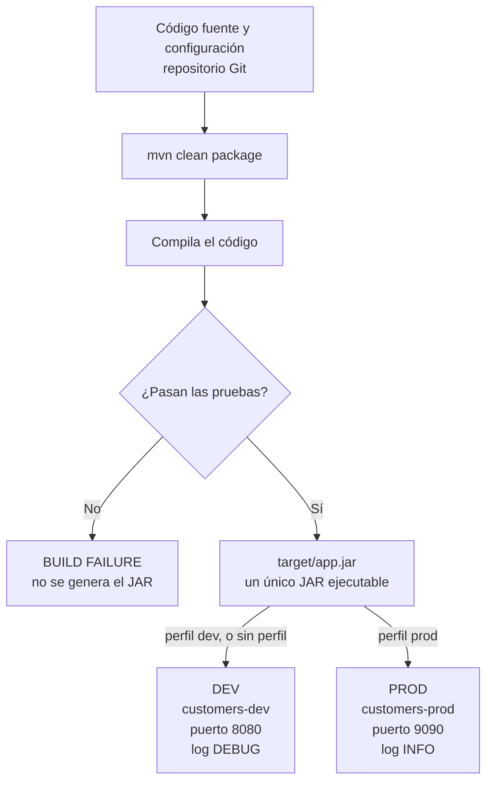

# Kata técnica: API de Clientes con Spring Boot

## Descripción

Esta es una aplicación que permite crear y consultar clientes. Fue desarrollada con Java 21, Spring Boot y Maven.

Su objetivo principal es construir un único archivo JAR que se ejecuta en dos ambientes: Desarrollo (DEV) y Producción (PROD), y cada ambiente tiene sus propias configuraciones. El ambiente de producción es un entorno simulado. El JAR se construye una vez, sin recompilar ni modificar el código entre ambientes.

Al iniciar la aplicación, se elige el ambiente con el que se quiere trabajar y se muestra un mensaje confirmando el ambiente, el nombre de la aplicación y el puerto en el que se está ejecutando.

## Requisitos

| Herramienta | Versión | Notas |
|---|---|---|
| Java (JDK) | 21 | Obligatorio |
| Maven | 3.9+ | Opcional: el proyecto incluye el wrapper (`mvnw` / `mvnw.cmd`) |
| Git | Cualquiera reciente | Para clonar el repositorio |
| Docker | Cualquiera reciente | Opcional: solo para ejecutar la aplicación en contenedores |

La aplicación también está desplegada en AWS: ver [Despliegue en la nube (AWS)](#despliegue-en-la-nube-aws).

Tecnologías usadas: Spring Boot 4.1.2 (Spring Web MVC y Validation). Maven las descarga al construir; no hay que instalarlas.

Los comandos de este documento se probaron en Windows 11 con PowerShell 7. También funcionan en Bash (Linux, macOS, Git Bash).

## ¿Cómo construir?

Clonar el repositorio y entrar a la carpeta:

```bash
git clone https://github.com/chartorresgg/kata-customers-lifecycle.git
cd kata-customers-lifecycle
```

Construir con Maven:

```bash
mvn clean package
```

Si no hay Maven instalado, usar el wrapper incluido:

```bash
.\mvnw.cmd clean package     # Windows (PowerShell o CMD)
./mvnw clean package         # Linux, macOS o Git Bash
```

Resultado: `target/app.jar`, un JAR ejecutable que incluye todas sus dependencias.

Si alguna prueba falla, el build se detiene y **no** se genera el JAR.

## ¿Cómo ejecutar el ambiente DEV (Desarrollo)?

```bash
java -jar target/app.jar --spring.profiles.active=dev
```

Resultado esperado al final del arranque:

```
Ejecutando en DEV | app=customers-dev | puerto=8080
```

Si se ejecuta sin indicar perfil (`java -jar target/app.jar`), la aplicación arranca en **DEV**, que es el perfil por defecto.

## ¿Cómo ejecutar el ambiente PROD (Producción)?

```bash
java -jar target/app.jar --spring.profiles.active=prod
```

Resultado esperado al final del arranque:

```
Ejecutando en PROD | app=customers-prod | puerto=9090
```

El perfil también se puede indicar con una variable de entorno:

```bash
# PowerShell
$env:SPRING_PROFILES_ACTIVE = "prod"
java -jar target/app.jar

# Bash
SPRING_PROFILES_ACTIVE=prod java -jar target/app.jar
```

DEV y PROD se pueden ejecutar al mismo tiempo, cada uno en su terminal, porque usan puertos distintos. Cada instancia guarda sus propios clientes en memoria.

Para detener la aplicación: `Ctrl + C`.

## Diferencias entre ambientes

El código y el JAR son los mismos. Solo cambia la configuración que se carga según el perfil.

| | DEV | PROD |
|---|---|---|
| Perfil | `dev` (por defecto) | `prod` |
| Archivo de configuración | `application-dev.properties` | `application-prod.properties` |
| Puerto | `8080` | `9090` |
| Nombre de la aplicación | `customers-dev` | `customers-prod` |
| Log de arranque | `Ejecutando en DEV` | `Ejecutando en PROD` |
| Nivel de log de la aplicación | `DEBUG` | `INFO` |

## Endpoints

Los ejemplos usan el puerto de DEV (`8080`). Para PROD, cambiar a `9090`.

| Método | Ruta | Qué hace | Respuestas |
|---|---|---|---|
| `POST` | `/api/customers` | Crea un cliente | `201` creado · `400` datos inválidos · `409` email ya registrado |
| `GET` | `/api/customers` | Lista los clientes, ordenados por id | `200` |
| `GET` | `/api/info` | Muestra el ambiente, el nombre y el puerto de la instancia | `200` |

```bash
# Crear un cliente
curl -X POST localhost:8080/api/customers -H "Content-Type: application/json" -d '{"name":"Ana","email":"ana@example.com"}'

# Listar los clientes
curl localhost:8080/api/customers
```

Respuestas de ejemplo y errores: [docs/api.md](docs/api.md).

## ¿Cómo ejecutar con Docker? (opcional)

```bash
# Construir la imagen (el punto final hace parte del comando)
docker build -t kata-customers .

# Ejecutar en DEV
docker run --rm -p 8080:8080 kata-customers

# Ejecutar en PROD
docker run --rm -p 9090:9090 -e SPRING_PROFILES_ACTIVE=prod kata-customers
```

La imagen es la misma para los dos ambientes: solo cambian la variable de entorno y el puerto. Detalle: [docs/docker-y-aws.md](docs/docker-y-aws.md).

## Despliegue en la nube (AWS)

La aplicación está desplegada en AWS (una instancia EC2 con Docker), en el ambiente PROD:

```bash
curl http://54.91.255.229:9090/api/info
curl http://54.91.255.229:9090/api/customers
```

> Es un despliegue temporal y esta instancia se eliminará después de la sustentación. Usa `http` (sin HTTPS) y solo debe recibir datos de ejemplo.

Cómo se desplegó y su seguridad: [docs/docker-y-aws.md](docs/docker-y-aws.md#despliegue-en-la-nube-aws).

## Ciclo de vida



La idea principal es que el JAR se construye una sola vez y se ejecuta en varios ambientes. El JAR que se prueba en DEV es el mismo que se ejecuta en PROD: solo cambia la configuración.

## Más detalle

| Documento | Contenido |
|---|---|
| [docs/api.md](docs/api.md) | Ejemplos de cada endpoint y respuestas de error |
| [docs/docker-y-aws.md](docs/docker-y-aws.md) | Etapas del `Dockerfile`, opciones de `docker run` y despliegue en AWS |
| [docs/decisiones.md](docs/decisiones.md) | Decisiones, limitaciones, prioridad de la configuración y ciclo de vida paso a paso |
