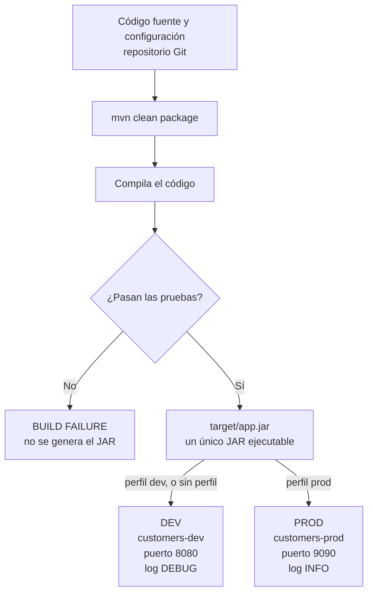

# Kata técnica: API de Clientes con Spring Boot

## Descripción

Esta es una aplicación que permite crear y consultar clientes. Fue desarrollada con Java 21, Spring Boot y Maven.

Su objetivo principal es construir un único archivo JAR que se ejecuta en dos ambientes: Desarrollo (DEV) y Producción (PROD), y cada ambiente tiene sus propias configuraciones. El ambiente de producción es un entorno simulado. El JAR se construye una vez, sin recompilar ni modificar el código entre ambientes.

Al iniciar la aplicación, se elige el ambiente con el que se quiere trabajar y se muestra un mensaje confirmando el ambiente, el nombre de la aplicación y el puerto en el que se está ejecutando.


## Requisitos

| Herramienta | Versión | Notas |
|---|---|---|
| Java (JDK) | 21 | Obligatorio |
| Maven | 3.9+ | Opcional: el proyecto incluye el wrapper (`mvnw` / `mvnw.cmd`) |
| Git | Cualquiera reciente | Para clonar el repositorio |

Tecnologías usadas: Spring Boot 4.1.2 (Spring Web MVC y Validation). Maven las descarga al construir; no hay que instalarlas.

Los comandos de este documento se probaron en Windows 11 con PowerShell 7. También funcionan en Bash (Linux, macOS, Git Bash).

## ¿Cómo construir?

Clonar el repositorio y entrar a la carpeta:

```bash
git clone https://github.com/chartorresgg/kata-customers-lifecycle.git
cd kata-customers-lifecycle
```

Construir con Maven:

```bash
mvn clean package
```

Si no hay Maven instalado, usar el wrapper incluido:

```bash
.\mvnw.cmd clean package     # Windows (PowerShell o CMD)
./mvnw clean package         # Linux, macOS o Git Bash
```

Qué hace el comando:

1. `clean` borra la carpeta `target/`.
2. `package` compila el código, ejecuta las pruebas y empaqueta la aplicación.

Resultado: `target/app.jar`, un JAR ejecutable que incluye todas sus dependencias.

Si alguna prueba falla, el build se detiene y **no** se genera el JAR.

## ¿Cómo ejecutar el ambiente DEV (Desarrollo)?

```bash
java -jar target/app.jar --spring.profiles.active=dev
```

Resultado esperado al final del arranque:

```
Ejecutando en DEV | app=customers-dev | puerto=8080
```

Si se ejecuta sin indicar perfil (`java -jar target/app.jar`), la aplicación arranca en **DEV**, que es el perfil por defecto.

## ¿Cómo ejecutar el ambiente PROD (Producción)?

```bash
java -jar target/app.jar --spring.profiles.active=prod
```

Resultado esperado al final del arranque:

```
Ejecutando en PROD | app=customers-prod | puerto=9090
```

El perfil también se puede indicar con una variable de entorno:

```bash
# PowerShell
$env:SPRING_PROFILES_ACTIVE = "prod"
java -jar target/app.jar

# Bash
SPRING_PROFILES_ACTIVE=prod java -jar target/app.jar
```

DEV y PROD se pueden ejecutar al mismo tiempo, cada uno en su terminal, porque usan puertos distintos. Cada instancia guarda sus propios clientes en memoria.

Para detener la aplicación: `Ctrl + C`.

## Endpoints

Los ejemplos usan el puerto de DEV (`8080`). Para PROD, cambiar a `9090`.

| Método | Ruta | Qué hace | Respuestas |
|---|---|---|---|
| `POST` | `/api/customers` | Crea un cliente | `201` creado · `400` datos inválidos · `409` email ya registrado |
| `GET` | `/api/customers` | Lista los clientes, ordenados por id | `200` |
| `GET` | `/api/info` | Muestra el ambiente, el nombre y el puerto de la instancia | `200` |

### Crear un cliente

```bash
curl -X POST localhost:8080/api/customers -H "Content-Type: application/json" -d '{"name":"Ana","email":"ana@example.com"}'
```

Respuesta `201 Created`:

```json
{"id":1,"name":"Ana","email":"ana@example.com"}
```

El `id` lo asigna el servidor. El email se guarda en minúsculas.

> En Windows PowerShell 5.1, el JSON debe escribirse con las comillas escapadas: `'{\"name\":\"Ana\",\"email\":\"ana@example.com\"}'`.

### Listar los clientes

```bash
curl localhost:8080/api/customers
```

Respuesta `200 OK`:

```json
[{"id":1,"name":"Ana","email":"ana@example.com"}]
```

### Consultar el ambiente

```bash
curl localhost:8080/api/info
```

Respuesta `200 OK`:

```json
{"environment":"DEV","application":"customers-dev","port":8080}
```

### Respuestas de error

Los errores usan el formato estándar `ProblemDetail` (RFC 9457).

Datos inválidos (`name` vacío, `email` vacío o con formato incorrecto), `400 Bad Request`:

```json
{
  "title": "Datos inválidos",
  "status": 400,
  "detail": "Los datos enviados no son válidos.",
  "instance": "/api/customers",
  "errors": { "email": "El email debe ser válido" }
}
```

Email ya registrado (sin distinguir mayúsculas), `409 Conflict`:

```json
{
  "title": "Cliente duplicado",
  "status": 409,
  "detail": "Ya existe un cliente con ese correo.",
  "instance": "/api/customers"
}
```

## Diferencias entre ambientes

El código y el JAR son los mismos. Solo cambia la configuración que se carga según el perfil.

| | DEV | PROD |
|---|---|---|
| Perfil | `dev` (por defecto) | `prod` |
| Archivo de configuración | `application-dev.properties` | `application-prod.properties` |
| Puerto | `8080` | `9090` |
| Nombre de la aplicación | `customers-dev` | `customers-prod` |
| Log de arranque | `Ejecutando en DEV` | `Ejecutando en PROD` |
| Nivel de log de la aplicación | `DEBUG` | `INFO` |

Por el nivel de log, el mensaje `Consultando todos los clientes registrados` aparece en la consola de DEV al listar los clientes, y no aparece en PROD.

La configuración común (por ejemplo, el perfil por defecto) está en `application.properties`.

Orden de prioridad de la configuración, de mayor a menor: línea de comandos, variables de entorno, `application-{perfil}.properties`, `application.properties`. Por ejemplo, este comando arranca PROD en el puerto 9999 sin cambiar ningún archivo:

```bash
java -jar target/app.jar --spring.profiles.active=prod --server.port=9999
```

## Decisiones y limitaciones

### Decisiones

- **Perfil por defecto:** Si no se elige un perfil al iniciar la aplicación, esta cargará el perfil DEV por la configuración `spring.profiles.default=dev`, que se encuentra en `application.properties`.

  Esta decisión se debe a que representa un menor riesgo iniciar la aplicación por descuido en modo DEV que en modo PROD.

- **Almacenamiento:** Cada instancia maneja sus propios datos, los cuales estarán almacenados en un almacén en memoria seguro para múltiples hilos y cuya estructura de datos es un `Map`.

  No se usa una base de datos dado que no hace parte del alcance de los requerimientos y, principalmente, porque el objetivo de la kata es el ciclo de vida.

- **Concurrencia:** Se decidió utilizar un `ConcurrentHashMap` en lugar de un `HashMap`, ya que es más seguro para trabajar con múltiples hilos (solicitudes) al mismo tiempo; un `HashMap` puede generar pérdida de datos o lanzar un error al leer mientras otro hilo escribe.

  También se decidió usar `AtomicLong` en lugar de un `long` tradicional, ya que permite modificar los valores de los IDs de forma segura entre múltiples hilos mediante operaciones atómicas. En cambio, con un `long`, la operación `id++` no es atómica y, por tanto, dos peticiones simultáneas podrían recibir el mismo ID.

- **Email único:** Si se crea un cliente con un email repetido, la aplicación mostrará que no es posible crear el cliente.

  El email se convierte a minúsculas antes de compararlo y guardarlo. La API responde con el código `409 Conflict`.

- **Validación:** Se valida que el nombre no sea un campo vacío y que el email, además de no ser vacío, cuente con el formato de correo (`@Email`). En caso de fallar, responderá con el código `400 Bad Request`, con el detalle por campo.

- **Formato de errores:** `ProblemDetail` es un estándar (RFC 9457) que Spring ya incluye y se usa en lugar de un JSON propio para garantizar interoperabilidad: cualquier cliente que conozca el estándar puede interpretar los errores automáticamente sin acoplarse a un formato personalizado.

- **Datos personales:** El email es un dato personal y no debe quedar en los logs. Este log de creación registra el ID y no el email.

- **Pruebas:** Se desarrollaron 3 clases y 8 pruebas:

  1. Unitarias del repositorio, que se encargan de validar la forma en la que los datos se guardan en el almacén de memoria.
  2. Perfil de producción, que se encarga de validar que el perfil de producción se ejecute correctamente de acuerdo a los valores de los archivos `properties`.
  3. `CustomersApplicationTests`, que se encarga de verificar que la aplicación arranque.

  Estas pruebas se llevan a cabo al ejecutar el comando `mvn clean package`. Si llegan a fallar, no se genera el archivo JAR.

  No se usa Mockito ya que no hay dependencias externas, como una base de datos u otra API. Es decir, no hay nada que aislar.

### Limitaciones

- **Memoria volátil:** De acuerdo al diseño de la aplicación y el requerimiento de usar un ambiente de producción simulado, la memoria volátil implica que no se guarden los datos de los clientes que se hayan creado al reiniciar la aplicación. Cada instancia, al ser un proceso con su propia memoria, gestiona sus datos por separado.

- **Una sola instancia:** `synchronized` verifica y guarda como un solo paso, dentro de una instancia. No resuelve el caso en que existen varias réplicas, que se resolvería con una restricción `UNIQUE` en una base de datos.

- **Validación del email:** La validación del email a través de `@Email` acepta correos que no tengan el componente `.com`, `.co`, `.org`, etc. Por ejemplo, acepta el correo `ana@example`.

- **Cobertura de pruebas:** Aún no se han desarrollado las pruebas de integración de la API: no están probados los endpoints de `/api/customers` ni la regla del email duplicado.

- **PROD simulado:** El ambiente de producción es una simulación en memoria y, por tanto, omite infraestructura productiva real: no persiste datos en una base de datos, no utiliza despliegue en la nube ni cifrado mediante HTTPS, y prescinde de credenciales reales (las cuales, en un entorno productivo real, se inyectarían mediante variables de entorno o un gestor de secretos).

## Ciclo de vida



El diagrama muestra el recorrido de la aplicación, desde el código hasta su ejecución en un ambiente:

1. **Código:** el código fuente y los tres archivos de configuración (`application.properties`, `application-dev.properties` y `application-prod.properties`) están en el repositorio.
2. **Construcción:** `mvn clean package` borra el resultado anterior, compila el código y ejecuta las pruebas.
3. **Pruebas:** si alguna prueba falla, el proceso se detiene y no se genera el JAR. Así, nunca se ejecuta una versión que no pasó las pruebas.
4. **Empaquetado:** si las pruebas pasan, se genera `target/app.jar`, un único JAR ejecutable que incluye las dependencias y las tres configuraciones.
5. **Ejecución:** el mismo JAR se ejecuta en DEV o en PROD. El ambiente se elige al arrancar, con el perfil, y cada uno carga su puerto, su nombre y su nivel de log.

La idea principal es que el JAR se construye una sola vez y se ejecuta en varios ambientes. El JAR que se prueba en DEV es el mismo que se ejecuta en PROD: solo cambia la configuración.

En esta kata los pasos se ejecutan a mano. En un entorno real los automatizaría una herramienta de integración y despliegue continuo (CI/CD): cada cambio en el repositorio dispararía la construcción y las pruebas, y el JAR resultante se desplegaría en cada ambiente.
